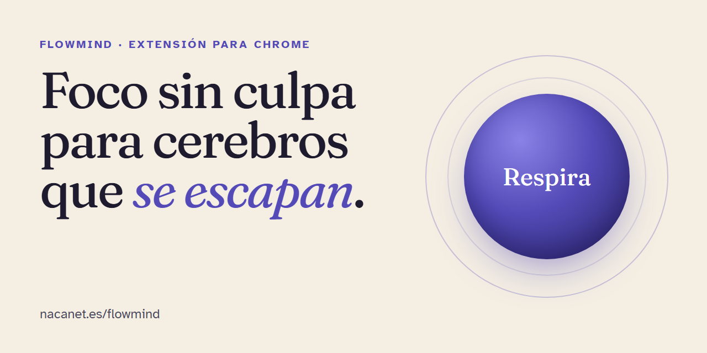

# FlowMind

[🇪🇸 Español](README.md) · 🇬🇧 English · [Landing](https://nacanet.es/flowmind/)

**Guilt-free focus for brains that drift.**
FlowMind is a Chrome extension for people with ADHD, autism or high ability. It notices when you have drifted away from your task and helps you come back with a breath and an honest question, without judging you.

## What it does

It sends five different alerts, each with its own breathing exercise and its own way out:

| Moment | When it fires |
|---|---|
| **You drift** | You open a distraction site (social, video, shopping…). |
| **You open an AI tool** | You open an AI tool while working on something else. |
| **You hop between tabs** | Five tab switches in two minutes. |
| **You can't stop for hours** | Over 90 minutes on the same task (adjustable): a reminder to drink water, move and rest. |
| **You're blocked** | The mouse moves, but the keyboard has been still for a while. |

Breathing patterns included: 4-7-8, box and 5-5.

It also includes:

- Real-time metrics: keys per minute and mouse movement.
- A focus-quality indicator that learns your personal rhythm.
- Task history with search, so you can pick a task back up where you left it.
- Pomodoro.
- Alerts and settings in Spanish and English.
- Settings: alert delay (3–30 s), distraction sites and pause.

## Privacy

Tasks, history and metrics are stored in the browser (`chrome.storage.local`). The extension **sends no data to any server**. To show the alert it needs to see the active tab, which is why it requests access to all websites.

## Status

| Component | Status |
|---|---|
| Chrome extension (Manifest V3) | Version 2.0, in testing. Manual install (developer mode). |
| Desktop app | In development. It will detect the active application across the whole system. |

## Access

The source code is not public. If you would like to try the extension, write to **hola@nacanet.es**.

---

A product by [nacanet](https://nacanet.es).
